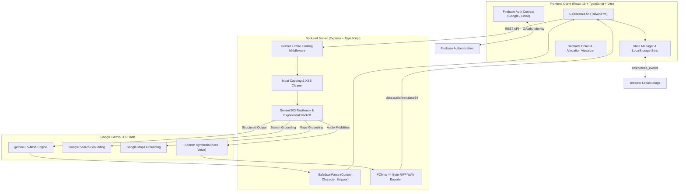

<div align="center">

# ✦ Celebranza ✦
### Autonomous Luxury Event Planning & Financial Intelligence Operating System

[](https://www.typescriptlang.org/)
[](https://react.dev/)
[](https://ai.google.dev/)
[](https://tailwindcss.com/)
[](https://vitejs.dev/)
[](https://expressjs.com/)
[](https://firebase.google.com/)
[](LICENSE)

<p align="center">
  <b>Celebranza</b> transforms high-stakes celebration planning into a seamless, deterministic science.<br/>
  Engineered with Google Gemini 3.5 Flash, structured output schemas, Google Search & Maps grounding, and real-time financial optimization for luxury weddings, milestone birthdays, and premier community galas.
</p>

[Key Features](#-core-capabilities) • [Gemini Architecture](#-gemini-35-flash-intelligence-layer) • [System Design](#-system-architecture) • [Getting Started](#-getting-started) • [API Contracts](#-api-specifications) • [Test Suite](#-automated-testing)

---

</div>

## 📌 Executive Summary & Problem Space

Planning high-stakes destination celebrations across premier Indian hubs (**Udaipur, Goa, Mumbai, Bengaluru**) presents major logistical and financial liabilities:

| Dimension | The Status Quo | The Celebranza Standard |
| :--- | :--- | :--- |
| **Budget Modeling** | Arbitrary rules of thumb and static spreadsheets resulting in 20–35% average budget overruns. | **Mathematically balanced category allocation** with real-time 80% overrun warning indicators. |
| **Market Intelligence** | Stale quotes, hidden administrative fees, and regional price opacity. | **Google Search & Maps grounded pricing** for authentic venues, catering per-plate rates, and production. |
| **Executive Oversight** | Scattered WhatsApp chats, disjointed email chains, and untracked deposits. | **Executive Voice Audio Briefings** powered by Gemini linear PCM wrapped in standard WAV containers. |
| **Ideation & Velocity** | Weeks spent writing briefs, gathering moodboards, and waiting for initial designer drafts. | **One-Prompt Event Architect** delivering a full itemized blueprint in under 3 seconds. |
| **Brand Identity** | Slow, expensive agency cycles for event logos and branding. | **Clean monogram branding** synthesized dynamically alongside color palettes and taglines. |

---

## ✨ Core Capabilities

### 1. ⚡ One-Prompt Event & Financial Architect
Transform a single natural language input (e.g., *"3-day destination beach wedding in South Goa, 180 guests, ₹35 Lakh budget"*) into an end-to-end event blueprint:
- **Mathematical Expense Distribution:** Computes exact rupee allocations across Venue, Catering, Decor, Photography, Attire, Entertainment, Invitations, and Emergency Reserves.
- **Venue Selection:** Authentically selects verified landmark venues (e.g., *The Leela Palace Bengaluru*, *Jagmandir Island Palace Udaipur*, *Candolim Beach Villas Goa*).
- **Target Milestones & Itemized Tasks:** Generates chronologically ordered planning checklists from 6 months out to day-of execution.

### 2. 📊 Financial Optimizer & Visual Risk Management
- **80% Category Allocation Cap:** Automated visual alert banner triggers whenever any category consumes 80% or more of its allocated budget, providing immediate mitigation steps.
- **Interactive Recharts Donut Breakdown:** Real-time visual expenditure analysis displaying spent amounts, allocated ceilings, and percentage consumption.
- **Strategic Advice Engine:** Instant market recommendations for contract negotiation, vendor bundles, and contin### 3. 🎙️ Executive Voice Audio Briefings
- Live audio briefings detailing countdown days, task readiness percentages, and upcoming milestones.
- Powered by dedicated Gemini speech models (`gemini-3.8-flash-tts` with seamless fallback to `gemini-3.8-flash-lite-tts`).
- Server-side streaming converts raw 16-bit 24kHz linear PCM audio from Gemini into a canonical 44-byte RIFF WAV header for native zero-dependency browser playback.
- Displays the active speech synthesis model badge in the audio briefing interface.

### 4. 🌐 Real-Time Search & Maps Grounding
- **Two-Step Architecture in One-Prompt Planner:**
  1. *Step 1 (Google Search Grounding):* Queries real-time banquet hall costs, venue pricing, and per-plate catering rates for the target city (e.g. Udaipur, Goa, Mumbai, Bengaluru).
  2. *Step 2 (Structured Schema Generation):* Feeds the grounded market pricing into the structured JSON `responseSchema` call, ensuring all estimates match verified market realities without mixing tools and JSON mode in a single call.
- **Vendors Tab Grounding:**
  - *Google Search:* Direct live vendor rates, reviews, and citation links.
  - *Google Maps:* Premier landmark venues with direct Google Maps navigation links.

### 5. 👥 Guest RSVP & Seating Analytics
- Tracks accepted, declined, and pending RSVPs with automated dietary requirement aggregation and dietary requirement breakdowns.

### 6. 📄 Multi-Format Executive Export
- Generates comprehensive event summaries in **PDF**, formatted **Markdown**, and structured **CSV** spreadsheets for immediate sharing with families, accountants, and production crews.

### 7. 🎨 Dual Luxury Editorial Theming
- **Obsidian Dark Mode:** Deep midnight obsidian (`#0d0f14`) with terracotta accents (`#E07A5F`) and charcoal glass cards.
- **Warm Italian Cream Light Mode:** Warm editorial linen (`#FAF7F2`) with high-contrast terracotta borders and zero text overlay collisions.

---

## 🧠 Gemini Intelligence Layer

Celebranza orchestrates Google Gemini models across specialized modalities:

```
┌────────────────────────────────────────────────────────────────────────┐
│                   GOOGLE GEMINI INTELLIGENCE SUITE                     │
└───────────┬────────────────┬─────────────────┬────────────────┬────────┘
            │                │                 │                │
            ▼                ▼                 ▼                ▼
   [Structured JSON]   [Audio Stream]   [Search Ground]   [Maps Ground]
            │                │                 │                │
      responseSchema        Linear PCM        googleSearch      googleMaps
    (Type.OBJECT/ARRAY)   (24kHz 16-bit)      (Live Rates)     (Venues)
            │                │                 │                │
            ▼                ▼                 ▼                ▼
     One-Prompt &      Executive Voice    Vendor Market      Landmark
   Budget Blueprint       Briefing         Intelligence      Discovery
```

| Route | Model | Modality | Output Contract |
| :--- | :--- | :--- | :--- |
| `/api/planning/one-prompt-planner` | `gemini-3.5-flash` | Two-Step: `googleSearch` → `responseSchema` | Two-step grounded event blueprint with mathematically balanced budget in INR (₹) and synthesized vector SVG logo |
| `/api/planning/tts-briefing` | `gemini-3.8-flash-tts` *(Fallback: `gemini-3.8-flash-lite-tts`)* | Audio Modality (`Kore`) | 24kHz linear PCM audio buffer encapsulated into 44-byte RIFF WAV container + model attribution |
| `/api/planning/quick-suggest` | `gemini-3.5-flash` | JSON / Text | Low-latency financial recommendations with categorized tags |
| `/api/planning/search-vendors` | `gemini-3.5-flash` | Tool Grounding (`googleSearch`) | Live Google Search market rates and citation links |
| `/api/planning/maps-vendors` | `gemini-3.5-flash` | Tool Grounding (`googleMaps`) | Google Maps venue locations and verified place references |
| `/api/planning/chat-planner` | `gemini-3.5-flash` | Conversational JSON | Interactive planning assistant synthesizing custom blueprints and dynamic SVG branding |
arch-vendors` | `gemini-3.5-flash` | Tool Grounding | Live Google Search market rates and citation links |
| `/api/planning/maps-vendors` | `gemini-3.5-flash` | Tool Grounding | Google Maps venue locations and verified place references |
| `/api/planning/chat-planner` | `gemini-3.5-flash` | Conversational JSON | Interactive planning assistant synthesizing custom blueprints on the fly |

---

## 🏛️ System Architecture



---

## 🔒 Security & Resiliency Engineering

1. **Transient 503 Spike Resiliency:**
   - Implements automated exponential backoff retry wrapper (`generateContentWithRetry`) across all endpoints to gracefully absorb transient 503 high-demand surges from cloud endpoints.
2. **Safe JSON Stream Parsing (`safeJsonParse`):**
   - Automatically sanitizes non-printable ASCII control characters (`0x00`–`0x1F`), strips markdown code fences (` ```json `), and extracts valid JSON payloads to prevent syntax crashes.
3. **Strict Zero-Secrets Policy:**
   - Sensitive environment variables (`.env`, credentials) are strictly gitignored. Build outputs and local caches are isolated.
4. **SVG & XSS Sanitization:**
   - All external media and vector strings pass through rigorous sanitizers stripping `<script>`, `<iframe>`, `<foreignObject>`, and event handlers.
5. **Rate Limiting & Defense-in-Depth:**
   - Express rate-limiter restricts traffic to 100 requests per 15-minute window per IP, paired with `helmet` HTTP headers and payload size boundaries.

---

## 🚀 Getting Started

### Prerequisites
- **Node.js**: v18.0.0 or higher
- **npm** or **bun**
- **Google Gemini API Key**: Obtain a key from [Google AI Studio](https://aistudio.google.com/app/apikey)

### 1. Clone & Install
```bash
git clone https://github.com/PRIME1895/celebranza.git
cd celebranza
npm install
```

### 2. Configure Environment
Create a `.env` file in the project root:
```env
# Google Gemini API Key (Required for live AI features)
GEMINI_API_KEY="AIzaSy..."

# Server Port (Defaults to 3000)
PORT=3000

# Optional: Firebase Authentication Web Configuration
VITE_FIREBASE_API_KEY=""
VITE_FIREBASE_AUTH_DOMAIN=""
VITE_FIREBASE_PROJECT_ID=""
VITE_FIREBASE_STORAGE_BUCKET=""
VITE_FIREBASE_MESSAGING_SENDER_ID=""
VITE_FIREBASE_APP_ID=""
```
> *Note: If no API key is provided, Celebranza automatically activates deterministic offline Demo Mode so the entire application remains fully testable without network access.*

### 3. Launch Development Server
```bash
npm run dev
```
Navigate to `http://localhost:3000` in your browser.

---

## 🧪 Automated Testing

Celebranza includes a native Node.js test suite validating financial formulas, data aggregation, security sanitizers, and audio buffer encoding:

```bash
npm test
```

### Verified Test Execution Output:
```
> celebranza@1.0.0 test
> tsx --test src/**/*.test.ts

✔ sanitizeInput limits string lengths and trims whitespace (0.568372ms)
✔ sanitizeSvg strips script, iframe, and inline event handlers (0.337711ms)
✔ addWavHeader generates a compliant 44-byte RIFF WAV audio buffer (0.18339ms)
✔ budget allocation math balances total expenditure and percentages (0.115628ms)
✔ API mock handles valid structured response with source: "gemini" (0.089636ms)
✔ escapeXml safely encodes &, <, >, and quotes (0.084614ms)
✔ safeJsonParse parses clean and markdown wrapped json with fallback (0.317989ms)
✔ formatCurrencyINR formats Indian Lakhs accurately (0.625371ms)
✔ formatLakhsShort formats condensed notation (0.10866ms)
✔ calculateEventProgress clamps between 0 and 100 (0.095209ms)
✔ calculateBudgetSummary computes spent, remaining, and percentage (0.113272ms)
✔ filterVendors accurately filters by status and search text (0.138443ms)
✔ validateEventInput handles valid and invalid payload (0.115634ms)
✔ calculateRSVPSummary aggregates accepted, declined, pending, and seats (0.126759ms)
✔ checkCategoryBudgetWarning detects categories exceeding 80% allocation (0.095238ms)
ℹ tests 15
ℹ suites 0
ℹ pass 15
ℹ fail 0
ℹ cancelled 0
ℹ skipped 0
ℹ todo 0
```

---

## 📦 Production Deployment

### Build Application
Compiles the React frontend using Vite and bundles the Express backend server into an optimized single binary via `esbuild`:
```bash
npm run build
```

### Start Production Server
```bash
npm start
```

### Create Clean Submission Archive
```bash
zip -r celebranza.zip . -x "node_modules/*" ".env" ".git/*" "dist/*" "server.js"
```

---

## 📡 API Specifications

### `POST /api/planning/one-prompt-planner`
Generates a complete event blueprint from natural language.
- **Body:** `{ "prompt": "Udaipur destination wedding, 250 guests, budget ₹45L", "eventType": "wedding" }`
- **Response:**
  ```json
  {
    "success": true,
    "source": "gemini",
    "model": "gemini-3.5-flash",
    "data": {
      "title": "Royal Lakeside Wedding",
      "type": "wedding",
      "city": "Udaipur",
      "venue": "Jagmandir Island Palace, Lake Pichola",
      "budget": 4500000,
      "expectedGuests": 250,
      "categoryBreakdown": [
        { "category": "Venue & Catering", "amount": 1890000, "percentage": 42, "note": "Island palace banquet & premium catering" }
      ],
      "milestones": [ ... ],
      "itemizedExpenses": [ ... ]
    }
  }
  ```

### `POST /api/planning/quick-suggest`
Provides strategic financial allocations and contingency recommendations.
- **Body:** `{ "budget": 2000000, "eventType": "wedding", "currentPhase": "Planning" }`
- **Response:**
  ```json
  {
    "success": true,
    "source": "gemini",
    "model": "gemini-3.5-flash",
    "data": {
      "suggestion": "Allocate 40% to venue and catering, 20% to design, and reserve a strict 15% contingency fund.",
      "tags": ["BudgetAllocation", "FinancialBuffer", "RiskMitigation"]
    }
  }
  ```

### `POST /api/planning/tts-briefing`
Returns synthesized audio briefing for active celebration with dedicated TTS models.
- **Body:** `{ "eventTitle": "Sunset Beach Wedding", "daysLeft": 95, "progress": 47, "upcomingTask": "Finalize floral arch and sound check", "budgetSpent": "56%" }`
- **Response:**
  ```json
  {
    "success": true,
    "source": "gemini",
    "model": "gemini-3.8-flash-tts",
    "audioDataUrl": "data:audio/wav;base64,UklGR...",
    "briefingText": "Good morning! Here is your executive briefing for Sunset Beach Wedding..."
  }
  ```

---

## 🎨 Design Tokens & Aesthetic Standards

- **Heading Typography:** `DM Serif Display` (Google Fonts)
- **Body & Data Typography:** `Inter` (Google Fonts)
- **Primary Accent:** Terracotta `#E07A5F`
- **Background Palette:**
  - Dark Mode: Obsidian `#0d0f14` | Card `#161822` | Surface `#1f2230`
  - Light Mode: Italian Warm Linen `#FAF7F2` | Card `#F4EFE6` | Surface `#EDE6D9`
- **Status Indicators:**
  - Success / On Track: Emerald `#10B981`
  - Warning / >80% Budget Cap: Crimson `#EF4444`
  - Pending / Active: Amber `#F59E0B`

---

## 📄 License & Attribution

This project is open-source under the **[MIT License](LICENSE)**.

Developed by **[PRIME1895](https://github.com/PRIME1895)** for the Google Gemini Developer Challenge.
All intellectual property, code architecture, and designs are maintained in the public repository at [github.com/PRIME1895/celebranza](https://github.com/PRIME1895/celebranza).
