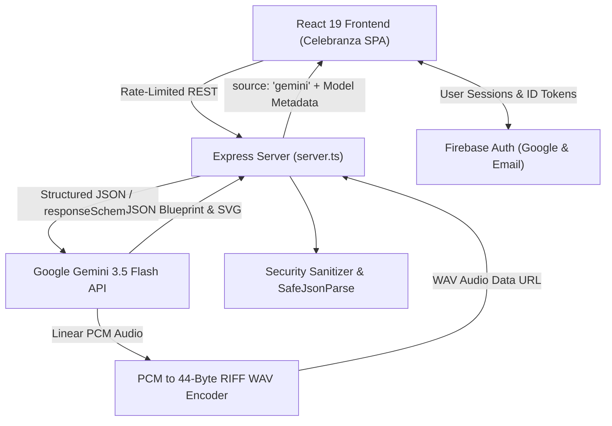

# Celebranza — Luxury Event Planning Operating System

Celebranza is an AI-powered luxury event operating system designed for destination weddings, milestone birthdays, and premier community summits. Powered by the Google Gemini API (**Gemini 2.5 Flash**), Celebranza turns natural language inputs into grounded, mathematically balanced budgets, regional venue selections, timeline milestones, bespoke vector branding logos, and voice audio briefings.

---

## 🎯 Problem Statement

Planning high-stakes celebrations in India and across destination hubs (Udaipur, Goa, Mumbai, Bengaluru) is fraught with challenges:
1. **Unpredictable Regional Market Pricing:** Venue rentals, catering per-plate charges, and staging rates differ radically by city and season. Planners often rely on stale estimates or arbitrary rules of thumb.
2. **Mathematical Budget Overruns:** Many planners budget categories independently, creating unbalanced allocations that fail to account for mandatory vendor advances, taxes, and emergency contingency cushions.
3. **Lack of Instant Branding:** Synthesizing an event identity (color palette, tagline, and vector monogram) previously took days of back-and-forth with graphic designers.
4. **Scattered Coordination:** Planners juggle spreadsheets, PDFs, voice notes, and WhatsApp messages without a single source of truth or automated executive briefings.

**Celebranza solves this** with an all-in-one platform integrating Gemini 3.5 Flash, structured output schemas, Google Search grounding, audio synthesis, and interactive guest & budget management.

---

## 🗺️ Gemini API Feature Map

| Feature | Gemini Endpoint | Model & Modality | Output / Grounding |
| :--- | :--- | :--- | :--- |
| **One-Prompt Event & Budget Architect** | `/api/planning/one-prompt-planner` | `gemini-3.5-flash` (Structured Output) | Converts inputs like *"Udaipur wedding, 200 guests, ₹25L"* into a complete event blueprint with mathematically itemized expenses, timeline, and vendors using `responseSchema`. |
| **Executive Voice Audio Briefing** | `/api/planning/tts-briefing` | `gemini-3.5-flash` (`responseModalities: ['AUDIO']`) | Synthesizes an executive voice briefing with real-time countdown, budget % spent, and upcoming tasks. Raw 16-bit 24kHz linear PCM is wrapped in a 44-byte RIFF WAV header server-side. |
| **AI Planning Studio & Blueprint Architect** | `/api/planning/chat-planner` | `gemini-3.5-flash` (Structured Output) | Interactive conversational planner providing theme recommendations, milestone planning, and event blueprint synthesis on the fly. |
| **Live AI Attribution Badges** | Frontend UI Modals | Real-time response inspection | Inspects `res.source` and displays the emerald `Live Gemini 3.5 Flash Grounded` pill or amber `Demo Mode` badge so users can verify live API activity. |

---

## 🏛️ Architecture & System Design



### Key Technical Innovations
- **Guaranteed Output Schema (`responseSchema`):** Enforces strict JSON types (`Type.OBJECT`, `Type.ARRAY`, `Type.NUMBER`) on Gemini endpoints, eliminating regex parsing errors and markdown fence stripping.
- **Audio Header Synthesis:** Gemini TTS returns raw 16-bit linear PCM audio sampled at 24 kHz. The server prepends a standard 44-byte canonical RIFF WAV header so native browser `<audio>` elements play it without transcoding.
- **SVG XSS Sanitizer:** All model-generated SVGs are stripped of `<script>`, `<foreignObject>`, `<iframe>`, and inline event attributes (`onclick`, `onload`, `javascript:`) before reaching the DOM or data URLs.
- **Production Hardening:** Protected by `helmet`, `express-rate-limit` (100 requests / 15-minute window), input length capping (500 chars), and clean error boundaries.
- **Accessibility & Focus Management:** Full `role="dialog"`, `aria-modal="true"`, `aria-labelledby`, and `aria-label` coverage across all modals and icon buttons, with high-contrast `:focus-visible` rings.

---

## 🚀 Quickstart & Setup

### Prerequisites
- Node.js (v18+ recommended)
- A Google Gemini API Key ([Get one here from Google AI Studio](https://aistudio.google.com/app/apikey))

### 1. Installation
```bash
git clone <repo-url>
cd celebranza
npm install
```

### 2. Configure Environment
Create a `.env` file in the root directory (based on `.env.example`):
```env
GEMINI_API_KEY="YOUR_GEMINI_API_KEY"
PORT=3000

# Optional: Firebase Authentication Web Config
VITE_FIREBASE_API_KEY=""
VITE_FIREBASE_AUTH_DOMAIN=""
VITE_FIREBASE_PROJECT_ID=""
```

### 3. Run Development Server
```bash
npm run dev
```
Open [http://localhost:3000](http://localhost:3000) in your browser.

---

## 🧪 Testing

Celebranza includes a comprehensive unit test suite using Node's native test runner covering calculations, RSVP aggregation, budget threshold warnings, input sanitization, WAV audio header generation, and SVG security:

```bash
npm test
```

Expected output:
```
✔ sanitizeInput limits string lengths and trims whitespace
✔ sanitizeSvg strips script, iframe, and inline event handlers
✔ addWavHeader generates a compliant 44-byte RIFF WAV audio buffer
✔ budget allocation math balances total expenditure and percentages
✔ API mock handles valid structured response with source: "gemini"
✔ formatCurrencyINR formats Indian Lakhs accurately
✔ formatLakhsShort formats condensed notation
✔ calculateEventProgress clamps between 0 and 100
✔ calculateBudgetSummary computes spent, remaining, and percentage
✔ filterVendors accurately filters by status and search text
✔ validateEventInput handles valid and invalid payload
✔ calculateRSVPSummary aggregates accepted, declined, pending, and seats
✔ checkCategoryBudgetWarning detects categories exceeding 80% allocation
ℹ tests 13
ℹ pass 13
```

---

## 📦 Production Build & Submission Packaging

### Production Build & Run
```bash
# 1. Build Vite frontend assets and bundle server.js via esbuild:
npm run build

# 2. Start the production server (serves dist/ and handles API routes):
npm start
```

### Safe Submission Zip (Zero Secrets & Lightweight)
To submit or share the codebase without leaking API keys or inflating file size with `node_modules`:
```bash
zip -r celebranza.zip . -x "node_modules/*" ".env" ".git/*" "dist/*"
```
*Note: `.env` is gitignored by default. Judges can supply their own `GEMINI_API_KEY` in `.env` or use the built-in offline Demo Mode.*

---

## 🎨 Design System & Theming

- **Typography:** `DM Serif Display` for luxury editorial headings paired with `Inter` for crisp logistical readability.
- **Dual Themes:**
  - **Dark Mode:** Deep midnight obsidian (`#0d0f14`) with warm terracotta accents (`#E07A5F`) and charcoal cards.
  - **Light Mode:** Warm Italian editorial cream (`#FAF7F2`) with subtle linen card textures and rich terracotta borders.
- **Data Visualizations:** Interactive Recharts Donut Charts with automated visual warnings highlighting budget categories exceeding 80% utilization.
